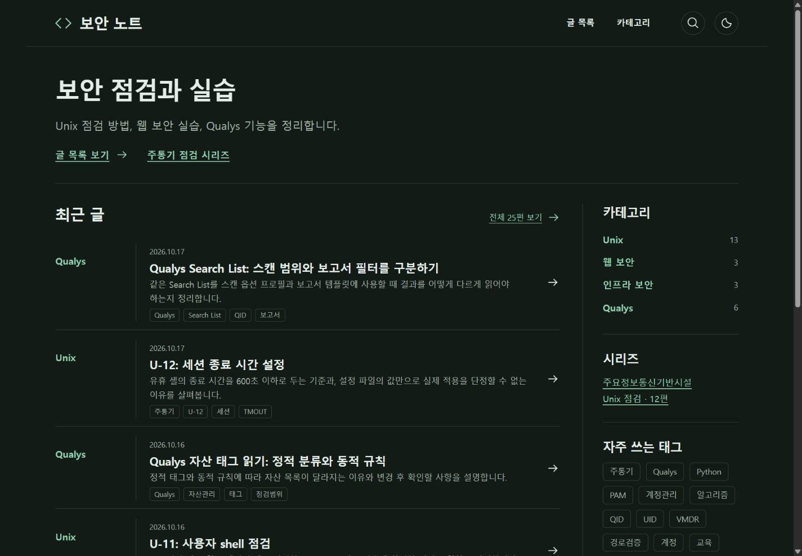
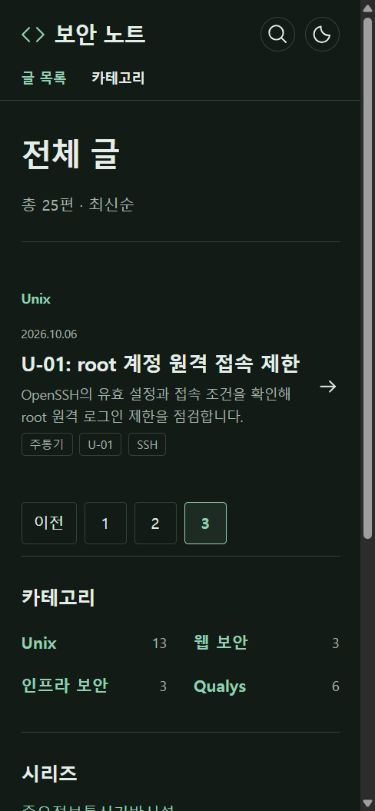
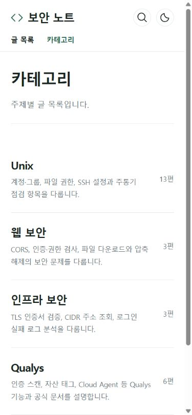
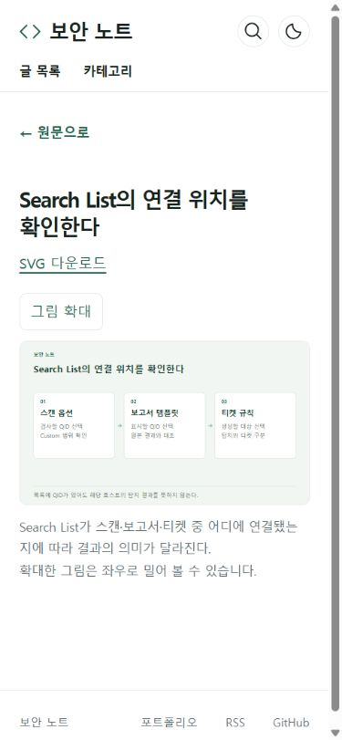
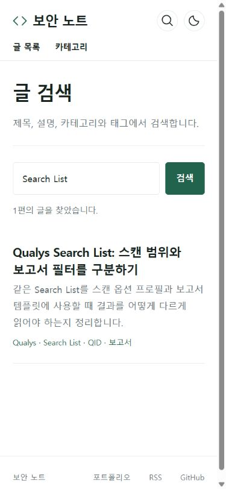

# 블로그 화면·문체·구성 검토

검토일: 2026-10-17. 대상: 보안 노트의 공개 글 25편과 홈·전체 목록·카테고리·본문·그림 보기·검색·시리즈. 기존의 문구 수정과 모바일 그림 수정은 유지하고, 이번에는 탐색 구조와 반복 문구를 중심으로 확인했다. 같은 범위를 다시 요청받으면 이 기록 이후의 변경과 새 문제부터 살핀다.

## 1. 변경 사항과 판단

현재 글은 점검 조건과 코드·출력의 연결이 구체적이다. 색상·시스템 글꼴·목차·코드 표시도 유지할 만하다. 전면 디자인 교체보다 긴 목록과 반복되는 설명을 줄이는 쪽이 효과가 크다고 판단했다.

| 화면/내용 | 발견한 문제 | 반영한 변경 |
| --- | --- | --- |
| 홈 | 글 25편이 모두 나열돼 오래된 글과 모바일 주제 탐색까지 스크롤이 길어짐 | 최근 8편, 전체 목록 링크, 모바일 상단 주제 링크 |
| 전체 글 | 독립적인 최신순 탐색 페이지가 없음 | 12편씩 페이지를 나눈 전체 목록. 번호·이전·다음 링크와 사이트맵 |
| 카테고리 | CVE 0편이 목록·사이드바·사이트맵에 노출됨 | 공개 카테고리와 생성 경로에서 CVE 제외. 비공개 초안을 공개하거나 채우기 글을 만들지 않음 |
| 사이드바 | 개별 U-번호를 포함한 52개 태그가 길게 나열됨 | 번호 태그를 제외한 자주 쓰는 12개와 전체 태그 링크 |
| Qualys 5편 | 문서 해설임을 매번 선언하고 제품 미사용 문구를 서문에 반복함 | 실제 문제 설명으로 바로 이어지도록 서문 정리. 구독·권한·실습 범위처럼 판단에 필요한 조건은 해당 내용 옆에 유지 |
| U-11·Qualys 태그 글 | 끝의 확인 날짜와 형식적인 마무리 | 화면 문구 제거, 기존 확인일은 sourcesChecked 메타데이터에 보관 |
| 도식 25개 | 공통 머리말 ‘구조로 읽기’가 내용과 무관하게 반복됨 | 블로그 이름만 남김. 기존 제목·설명·대체 텍스트·캡션 보존 |
| 모바일 카테고리 | ‘13편’이 숫자와 단위로 줄바꿈됨 | 글 수를 한 줄로 유지 |

관련 파일: src/lib/site.ts, src/pages/index.astro, src/pages/archive/[page].astro, src/components/TopicRail.astro, src/layouts/BaseLayout.astro, src/pages/posts/[...id].astro, src/pages/categories/index.astro, src/pages/sitemap.xml.ts, src/styles/global.css, src/content.config.ts, 수정한 글 6편, 도식 생성기와 SVG 25개.

### 글의 유지·삭제

공개 글은 삭제하지 않았다. U-01~U-12는 서로 다른 공식 점검 항목이고, umask·기본 ACL 실습도 별도 주제다. 웹 보안 3편은 CORS·다운로드 경로·압축 해제량이라는 다른 문제를 다룬다. 인프라 보안 3편은 TLS 검증·CIDR 조회·로그 시간 구간 분석이며 코드와 관찰 결과가 있다. Qualys 6편은 시작 안내·학습 환경·수집 경로·인증 결과·태그·Search List로 구분된다. 넓은 소개 글과 상세 글의 일부 설명은 겹치지만, 소개 글의 읽기 순서와 세부 글의 확인 절차가 달라 현재는 유지했다.

공개 목록은 총 25편(Unix 13·웹 보안 3·인프라 보안 3·Qualys 6)이다. 초안·미래 글은 계속 비공개다. 이번 검토는 제목·설명·도입·소제목·반복 문구·탐색 구조를 대상으로 했다. 기존 모든 기술 주장의 최신 공식 원문을 다시 대조하거나 기존 실습 전체를 재실행한 검토는 아니다. 기존 코드와 저장된 실행 기록의 일치는 회귀 검사로 확인한다.

### 이름과 주소

표시 이름 ‘보안 노트’와 /security-blog/ 주소를 유지한다. 목적을 알아보기 쉽고 포트폴리오·PDF·기존 게시물 링크의 연속성도 지킬 수 있다. 이름의 개성을 높이기 위해 지금 저장소를 바꿀 필요는 없다. 주소를 바꾸는 작업은 리디렉션·canonical·RSS·포트폴리오 링크까지 묶어 별도로 검토해야 한다.

## 2. 예약 작업과 검증

Codex 예약을 한국 시간 매일 18:30으로 변경했다. 주말도 같은 시각이다. 주통기와 Qualys는 각각 최대 1편, 수·토에는 새로 실습할 가치가 있는 웹·인프라 글을 최대 1편 검토한다. 추가 글은 월~일 기준 주 2편 이내이고 초안·수동 글도 센다. 품질 기준 미달·중복·실행 불가이면 해당 글을 보류하며 하루 0~3편을 허용한다.

GitHub의 비활성 클라우드 설정도 같은 시간과 기준으로 변경했다. 평일 18시 이전 차단, 추가 글 중복·주간 상한, 공식 출처·코드 실행·비밀 값·경로 검증을 적용했다. 검사나 격리 옵션을 완화하지 않았다. 확인일은 화면 대신 sourcesChecked에 저장하고 참고 링크는 문서 제목을 사용한다. 다음 Unix 번호를 고정하지 않으며 빈 CVE 메뉴와 상단 포트폴리오 탭을 다시 만들지 않도록 작성 지침에 명시했다.

로컬 검증: 테스트 23개, Astro 오류·경고·힌트 0개, 빌드 116페이지·공개 글 25편·10,058개 산출물 검사 통과. YAML의 중복 키·구문과 생성 JSON 스키마도 확인했다. 테스트 첫 실행은 기존 초안도 주간 추가 글 수에 포함하는 조건을 기대값에서 빠뜨려 2개가 실패했다. 해당 기대값을 바로잡고 별도 주의 추가 글 검증 사례를 사용해 전부 재검증했다. 검사를 끄거나 격리 옵션을 바꾸지 않았다.

### 화면 검토 순서와 증거

1. 홈: 양호. 8편·전체 목록·태그 12개·CVE 미노출 확인. 1440·390·320px에서 가로 넘침 없음.
2. 전체 목록: 양호. 1~3페이지의 총 25편을 정적 검사로 대조하고, 모바일에서 3페이지 U-01까지 이동 확인.
3. 카테고리: 양호. 4개 주제와 글 수, 밝은 테마의 글 수 줄바꿈 수정 확인.
4. 본문과 그림: 양호. 실제 글 링크와 원문 복귀 주소 확인. 390px에서 그림이 약 330px로 맞춰지고 확대하면 960px, 페이지 자체의 가로 넘침 없음.
5. 검색과 시리즈: 양호. Search List 검색 1건과 실제 본문 이동 확인. 320px 시리즈·본문·전체 목록의 가로 넘침 없음. 검색 색인·RSS는 25편 유지.

현재 실행에서 캡처한 화면은 .qa/editorial-audit/에 보관한다. 01~04는 수정 전, 05 이후는 수정 후 화면이다. 이미지 로딩 전 빈 캡처와 브라우저 크기 변경 직후 잘못 축소된 캡처는 증거에서 제외하고 재촬영했다. 스크린샷만으로 접근성 적합성을 확정하지 않는다. 보조기기 전체 조합과 실제 휴대전화 기기 검사는 수행하지 않았다.

## 3. 보안·품질 검토

- 인증/권한 영향: 사이트 인증·배포 권한 변경 없음. 생성 단계의 읽기 전용 권한과 격리 실행 조건 유지.
- 민감정보 영향: 새 자격 증명·실제 고객 자료 없음. Secret 이름과 활성 변수만 조회했고 값을 수집하지 않음.
- 입력 검증 영향: 추가 글에도 기존 경로·중복·공식 HTTPS 호스트·마크업·실행 결과 검사를 적용. 출처 제목의 링크 문법 삽입을 차단.
- 로그 노출 가능성: 새로운 운영 로그 없음. 기존 실습 기록은 보존. 화면 캡처는 블로그만 포함.
- 기존 기능 회귀 가능성: 모든 공개 글과 기존 코드 95개의 날짜·해시 보존 검사. 검색·RSS·사이트맵·그림 링크 검사.
- 유지보수 리스크: 자동 문체·중복 검사는 편집 판단을 완전히 대신하지 않음. 전체 글 목록과 카테고리의 글 수는 동적으로 계산함. 클라우드 실제 API 생성 경로는 키 미등록으로 미검증.

## 4. 현재 상태

구현·로컬 정적 검사·내장 브라우저의 화면 검토를 마쳤다. 배포 실행은 이 문서를 포함한 main 커밋의 Actions 기록에서 확인한다. 현재 활성 예약은 로컬이며 PC와 앱이 켜져 있어야 실행된다. 2026-10-17 조회 시 DAILY_PUBLISH_ENABLED=false이고 OPENAI_API_KEY Secret은 없었다. 이 작업에서 키를 생성하거나 클라우드 예약을 활성화하지 않았다.

## 5. 다음 작업

- 작업명: 클라우드 무인 생성·발행 검증
- 목적: 개인 PC 전원과 무관한 일일 운영
- 변경 범위: 기존 승인 범위에서 인증 복구·안전한 Secret 등록·preview·발행 확인
- 완료 기준: 실제 생성과 공개 글을 확인하고 로컬 예약과 중복되지 않게 전환
- 검증 방법: API 사용 preview, 격리 실행, Actions 및 공개 글·그림·RSS 대조
- 주의사항: 키를 채팅이나 로그로 전달하지 않으며 검증 전 활성화하지 않음
